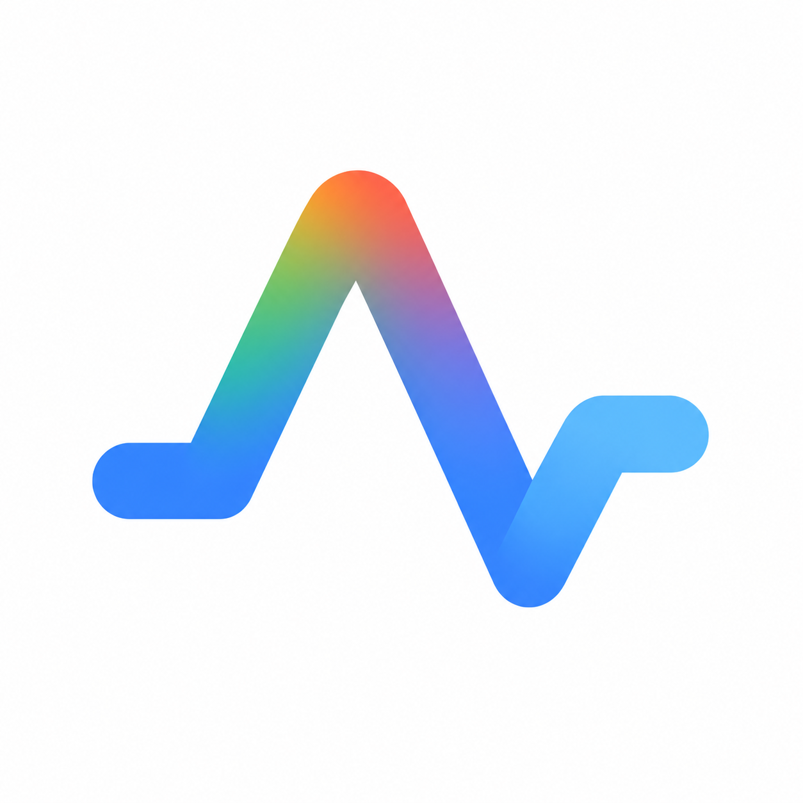
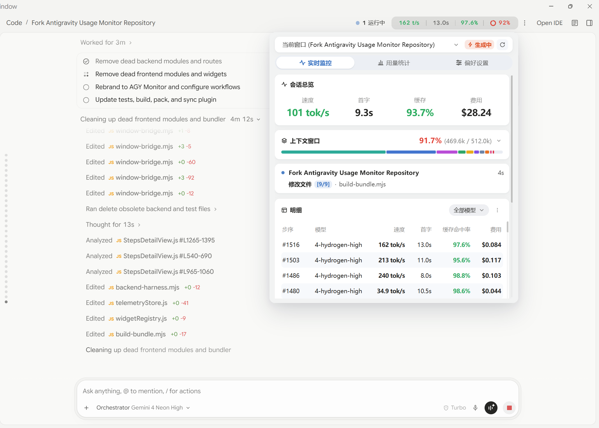
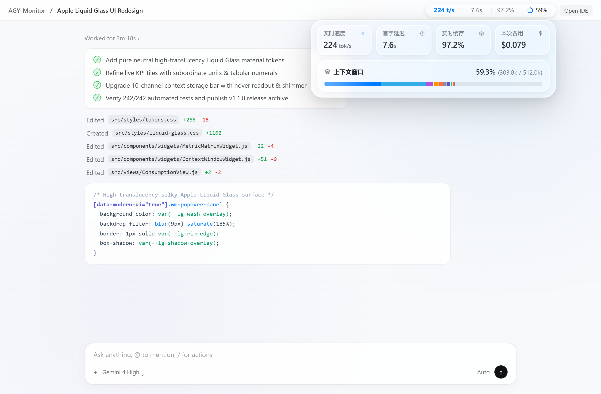
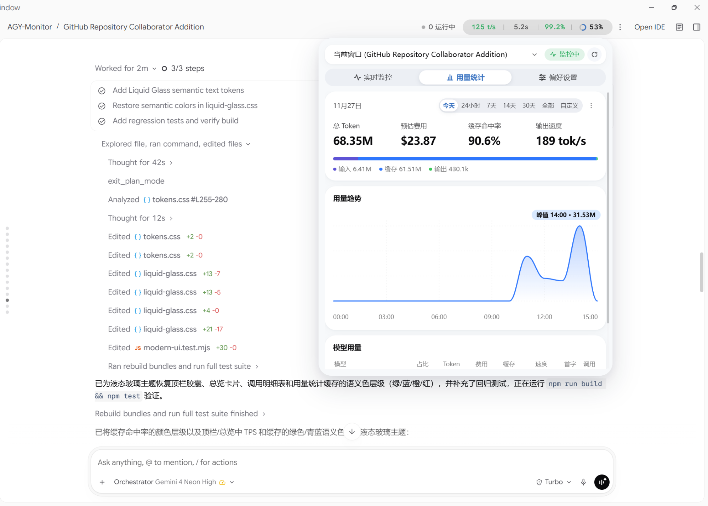
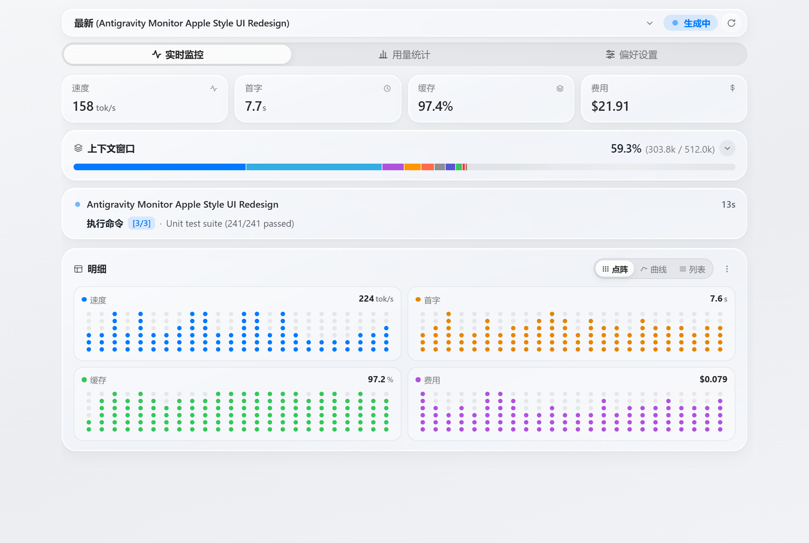

<div align="center">



# AGY Monitor

Lightweight local telemetry and token analytics plugin for Google Antigravity — zero external dependencies, zero credential access, built for clarity.

[](https://github.com/infinitex233/antigravity-usage-monitor/releases/latest)
[](https://github.com/infinitex233/antigravity-usage-monitor/releases)
[](https://github.com/infinitex233/antigravity-usage-monitor/stargazers)
[](LICENSE)
[](#local-development)
[](#client-support)

[简体中文](README.zh-CN.md) · English

[Why AGY Monitor](#why-agy-monitor) · [Screenshots](#screenshots) · [Features](#features) · [Installation](#installation) · [Local Development](#local-development) · [License](#acknowledgments--license)

<br />



<br />

[Latest Release](https://github.com/infinitex233/antigravity-usage-monitor/releases/latest) · [Download `usage-monitor.zip`](https://github.com/infinitex233/antigravity-usage-monitor/releases/latest/download/usage-monitor.zip)

</div>

---

## Why AGY Monitor

When working inside Antigravity, two questions matter most: **how fast is the current turn performing** (throughput, TTFT, live cache hit, context pressure), and **how many tokens and estimated dollars have been spent today and over recent weeks**.

**AGY Monitor** (streamlined from [`yuhuan-dev/antigravity-usage-monitor`](https://github.com/yuhuan-dev/antigravity-usage-monitor) and independently maintained from `v1.0.0`) strips away everything unrelated to pure telemetry:

- **Focused 3-Tab Interface**: Consolidated into **Live Monitor**, **Analytics**, and **Preferences** — removing subscription quota polling, account switching, quota reservation heuristics, cross-client session migration, and host UI translation injection.
- **Zero Account & Credential Surface**: Ships with no OAuth login flows and no PowerShell/DPAPI credential scripts. All metrics are read strictly from local Antigravity telemetry and trajectory caches.
- **Independent Releases & Pricing Sync**: Updates and releases target `infinitex233/antigravity-usage-monitor`, while public API pricing in [`pricing-catalog.json`](pricing-catalog.json) can be synced selectively via a standalone GitHub Actions workflow.

---

## Screenshots

<table>
  <tr>
    <td align="center" width="50%">
      
      <br />
      <b>Topbar Capsule &amp; Hover Card</b>
      <br />
      <sub>Live Speed, TTFT, Live Cache Hit, and Context Ring in the bar — plus Step Cost on hover</sub>
    </td>
    <td align="center" width="50%">
      
      <br />
      <b>Live Monitor (Popover)</b>
      <br />
      <sub>Session summary cards, 10-channel context breakdown, active task status, and embedded step table</sub>
    </td>
  </tr>
  <tr>
    <td align="center" width="50%">
      
      <br />
      <b>Usage Analytics</b>
      <br />
      <sub>Today / 24h / 6-month heatmap windows, color-coded token legend dots, and smooth trend curve</sub>
    </td>
    <td align="center" width="50%">
      
      <br />
      <b>Auxiliary Sidebar View</b>
      <br />
      <sub>Full-height sidebar layout with sortable per-step diagnostics and model breakdown</sub>
    </td>
  </tr>
</table>

---

## Features

### 1. Topbar Capsule & Quick Hover Card
- **Non-Invasive Mounting**: Injects overlays cleanly in memory over local CDP — **never modifies** the host `app.asar` bundle.
- **Instant Telemetry at a Glance**: Displays **Live Speed (`tok/s`) | TTFT | Live Cache Hit | Context Ring %** right in the titlebar; hover for a 4-card snapshot (**Live Speed, TTFT, Live Cache, Step Cost**) and context channel bar, click to toggle the 3-tab popover, or right-click to refresh.

### 2. Live Monitor: Session Summary, Context Channels & Step Table
- **Session Overview**: Tracks overall generation speed, average TTFT, cache hit rate, and cumulative estimated cost for the active thread.
- **10-Channel Context Window**: Visualizes how context capacity is divided across model replies, tool outputs, user turns, subagent notices, compaction summaries, system prompts, system tools, MCP tools, skills, and user rules — switchable between the main agent and any subagent/Swarm worker.
- **Embedded Call Details**: Browse, sort, and filter per-step timing, latency waterfalls, anomaly tags, and compaction events directly inside Live Monitor, or export reports as multi-sheet `.xlsx` workbooks or Markdown.
- **Version-First Compact Model Labels**: Cleaner short identifiers like `4-hydrogen-high` and `4-neon-high`.

### 3. Analytics: Trends, Full-Fit 6-Month Heatmap & Leaderboards
- **Preset & Custom Windows**: Inspect **Cycle**, **Today**, **24h**, **7d**, **14d**, **30d**, **All**, or custom date spans.
- **Token Composition & Breakdown Bar**: Input, cache read, and output totals paired with color-coded legend dots and a proportional segment bar.
- **Full-Fit 6-Month Calendar Heatmap**: Selecting **All** renders a 26-week daily activity heatmap scaled cleanly to the panel width with zero edge clipping or horizontal scrolling; shorter windows display smooth cubic Bezier trend curves.
- **Multi-Dimensional Rankings**: Compare usage, estimated USD cost, cache hit %, speed, and TTFT across models, project workspaces, and sessions, with `.xlsx` and Markdown export support.

### 4. Streamlined Single-Page Preferences
- Configure language (`Auto` / `简体中文` / `English`), accent theme, font scale (`sm / md / lg / xl`), model name formatting, mount mode (`Dual` / `Composer` / `Sidebar`), pricing catalog sync, update checks, and local cache rebuild on a single clean page.

---

## Client Support

| Client / Environment | Status Bar / Capsule | Monitor Panel | Offline Logs & SQLite | Modifies `app.asar` |
| :--- | :---: | :---: | :---: | :---: |
| **Antigravity 2.0 Desktop** | Titlebar / Composer | Hover Popover + Auxiliary Pane | Yes | No |
| **Antigravity IDE** | Titlebar / Composer | Capsule Popover | Yes | No |
| **Antigravity CLI (`agy`)** | Terminal `statusLine` | Standalone Web (`--port`) | Yes (SQLite + `.pbtxt`) | No |
| **SSH Remote / Headless** | Isolated per endpoint | Popover / `--token` Web UI | Yes | No |

---

## Installation

> [!IMPORTANT]
> Keep the installed directory named **`usage-monitor`**. No `npm install` step is needed.

### Option 1: Download Release Archive (Recommended)

Download [`usage-monitor.zip`](https://github.com/infinitex233/antigravity-usage-monitor/releases/latest/download/usage-monitor.zip) from [Releases](https://github.com/infinitex233/antigravity-usage-monitor/releases/latest) and extract it into `~/.gemini/config/plugins/` so the resulting directory is `~/.gemini/config/plugins/usage-monitor`.

<details>
<summary>Windows PowerShell one-liner</summary>

```powershell
$pluginsDir = "$env:USERPROFILE\.gemini\config\plugins"
New-Item -ItemType Directory -Path $pluginsDir -Force | Out-Null
Invoke-WebRequest -Uri "https://github.com/infinitex233/antigravity-usage-monitor/releases/latest/download/usage-monitor.zip" -OutFile "$env:TEMP\usage-monitor.zip"
Expand-Archive -Path "$env:TEMP\usage-monitor.zip" -DestinationPath $pluginsDir -Force
```

</details>

### Option 2: Git Clone

```powershell
# Windows (PowerShell)
git clone --filter=blob:none --single-branch https://github.com/infinitex233/antigravity-usage-monitor.git "$env:USERPROFILE\.gemini\config\plugins\usage-monitor"
```

```bash
# macOS / Linux
git clone --filter=blob:none --single-branch https://github.com/infinitex233/antigravity-usage-monitor.git ~/.gemini/config/plugins/usage-monitor
```

### Enable & Standalone Web Mode

1. Open **Customizations → Installed** in Antigravity and enable **AGY Monitor** (`usage-monitor`).
2. For **Antigravity IDE**, restart the IDE once after enabling to mount the titlebar capsule.
3. For headless/remote environments, launch the built-in standalone server (non-loopback bindings require `--token <secret>` or `USAGE_MONITOR_STANDALONE_TOKEN`):

```bash
node ~/.gemini/config/plugins/usage-monitor/sidecars/panel/standalone.mjs --port 8787
```

Settings and local trajectory caches persist under `~/.gemini/antigravity/sidecar_data/usage-monitor/`.

---

## Local Development

Both backend and frontend use pure Node.js ESM (Node.js 22.5+ recommended for built-in `node:sqlite`) and a lightweight custom reactive UI runtime (`defineComponent` + incremental DOM patching with Shadow DOM isolation) — **zero external npm dependencies**:

```bash
cd sidecars/panel

# Rebuild app.js and styles.css after editing src/
npm run build

# Run full unit & integration test suite
npm test

# Package clean runtime archive (dist/usage-monitor.zip)
npm run pack:release
```

---

## Acknowledgments & License

- **Upstream Attribution**: Forked and streamlined from [yuhuan-dev/antigravity-usage-monitor](https://github.com/yuhuan-dev/antigravity-usage-monitor). Huge thanks to the upstream author for the foundational telemetry collector, protobuf/SQLite readers, and overlay bridge architecture.
- **License**: Distributed under the [GNU General Public License v3.0](LICENSE).
