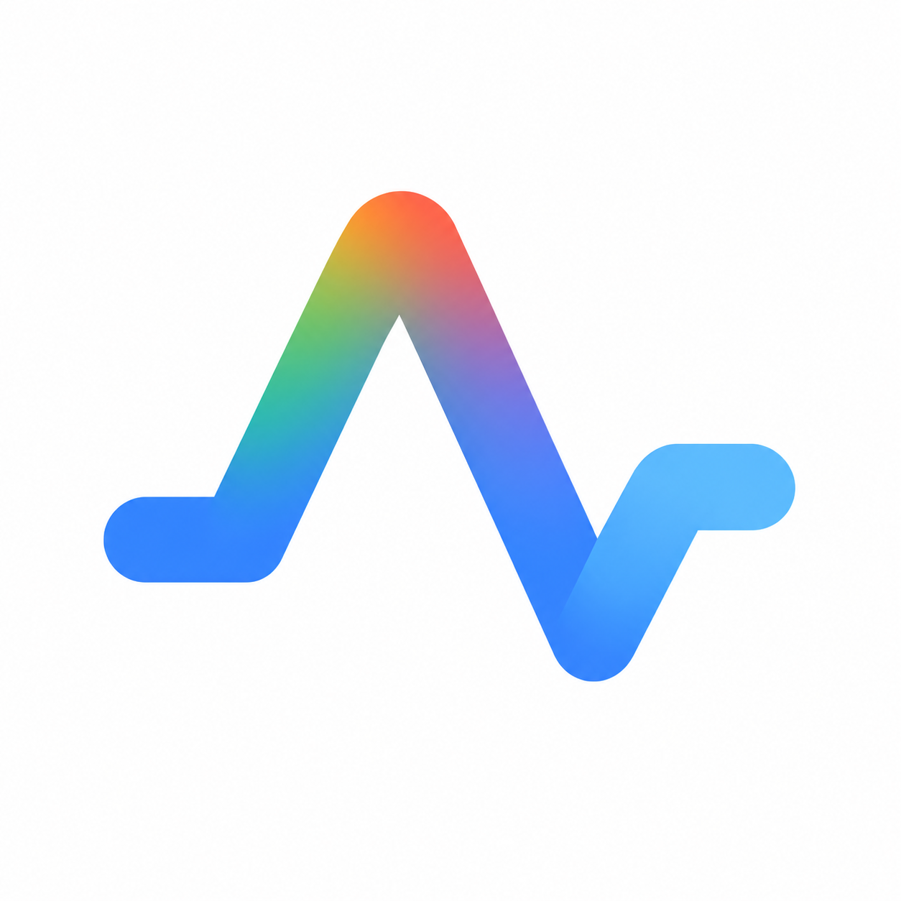
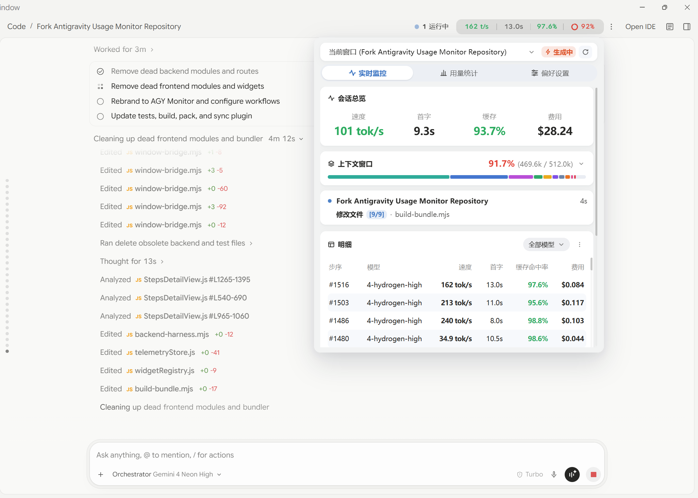
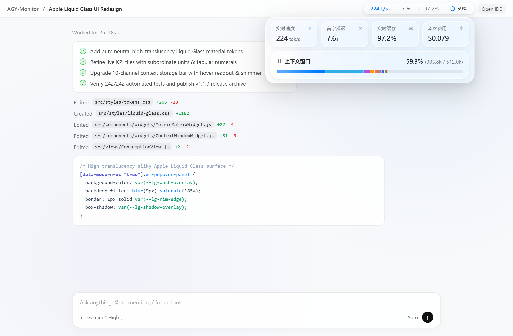
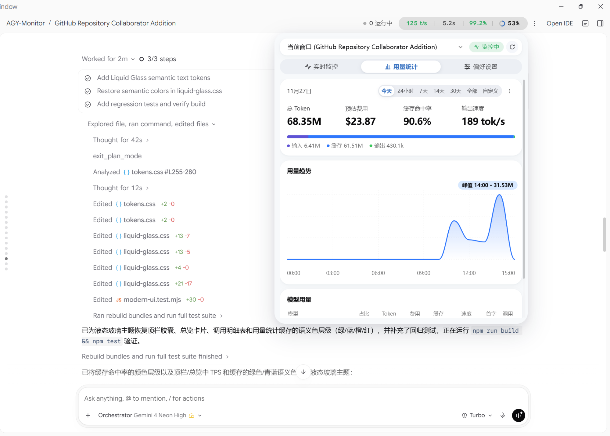
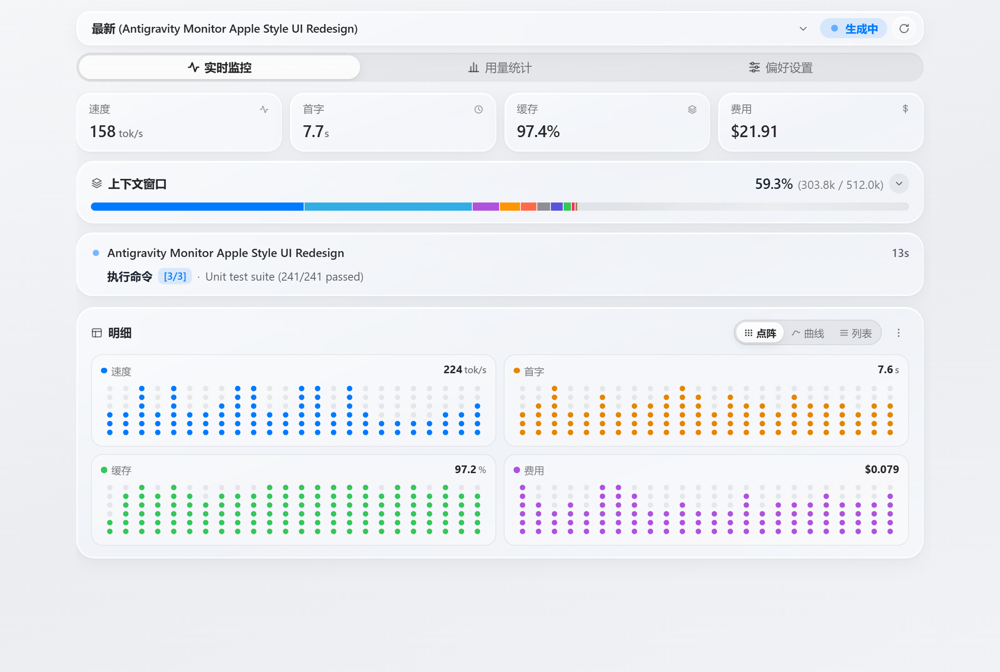

<div align="center">



# AGY Monitor

**Apple Liquid Glass 质感 · Google Antigravity 本地实时性能监控与 Token 分析插件**

支持液态玻璃 / 默认经典双主题热切换 · 2×2 四维点阵/曲线趋势 · 纯吐字 TPS · 零外部依赖 · 零账号凭证触碰

[](https://github.com/infinitex233/AGY-Monitor/releases/latest)
[](https://github.com/infinitex233/AGY-Monitor/releases)
[](https://github.com/infinitex233/AGY-Monitor/stargazers)
[](LICENSE)
[](#本地开发)
[](#多端支持)
[](https://linux.do)

简体中文 · [English](README.md)

[设计理念](#设计理念) · [界面预览](#界面预览) · [核心能力](#核心能力) · [安装与启用](#安装与启用) · [本地开发](#本地开发) · [致谢与许可](#致谢与许可)

<br />



<br />

[下载最新版本 (`v1.1.0`)](https://github.com/infinitex233/AGY-Monitor/releases/latest) · [直接下载 `agy-monitor.zip`](https://github.com/infinitex233/AGY-Monitor/releases/latest/download/agy-monitor.zip)

</div>

---

## 设计理念

日常使用 Antigravity 时，我们真正高频关注的其实就两件事：**这一步生成有多快（速度、首字、缓存、上下文还剩多少）**，以及**今天和近期到底烧了多少 Token 与费用**。

**AGY Monitor**（基于 [`yuhuan-dev/antigravity-usage-monitor`](https://github.com/yuhuan-dev/antigravity-usage-monitor) 精简重组，自 `v1.0.0` 起独立演进）秉持「克制、直觉、纯本地」的原则：

- **只保留核心监控**：去掉账号登录/切号、订阅额度轮询、配额预占估算、跨端会话迁移和宿主文案注入，界面回归干净的三栏结构（`实时监控` / `用量统计` / `偏好设置`）。
- **零账号风险面**：彻底移除 Google OAuth 流程与 PowerShell/DPAPI 本地凭证脚本，不读取、不存储任何账号令牌，所有数据严格来自本机 Antigravity 遥测与本地轨迹缓存。
- **独立发布与可选价格同步**：版本与更新完全托管在 `infinitex233/AGY-Monitor`，公开模型定价（[`pricing-catalog.json`](pricing-catalog.json)）可通过独立 GitHub Actions 工作流按需同步。

---

## 界面预览

<table>
  <tr>
    <td align="center" width="50%">
      
      <br />
      <b>顶栏胶囊与悬浮速览</b>
      <br />
      <sub>顶栏直显「实时速度 | 首字延迟 | 实时缓存 | 上下文」，悬停即见四项核心指标与本次费用</sub>
    </td>
    <td align="center" width="50%">
      
      <br />
      <b>实时监控（Liquid Glass 悬浮浮窗）</b>
      <br />
      <sub>纯吐字 TPS、10 通道上下文条、活跃任务状态与 2×2 四维点阵 / 曲线 / 列表三态切换</sub>
    </td>
  </tr>
  <tr>
    <td align="center" width="50%">
      
      <br />
      <b>用量统计</b>
      <br />
      <sub>支持今天 / 24 小时 / 半年日历热力图、总 Token 三色图例与平滑趋势曲线</sub>
    </td>
    <td align="center" width="50%">
      
      <br />
      <b>右侧辅助栏视图</b>
      <br />
      <sub>宽屏辅助栏常驻监控，完整呈现 2×2 四维同步点阵与步骤明细</sub>
    </td>
  </tr>
</table>

---

## 核心能力

### 1. 顶栏状态胶囊与悬浮速览
- **无侵入轻量挂载**：通过本地 CDP 在内存层渲染，**绝不修改**宿主 `app.asar` 安装包。
- **一眼掌握关键状态**：顶栏默认展示 **实时速度（`tok/s`）| 首字延迟（`TTFT`）| 实时缓存命中率 | 上下文环形占比**；鼠标悬停展开四卡速览（实时速度、首字延迟、实时缓存、本次费用）与上下文通道分布，点击开启完整面板，右键快速刷新。

### 2. 「实时监控」：纯吐字 TPS + 上下文拆解 + 2×2 四维趋势
- **纯吐字速度与四合一总览**：自动剔除首字排队/预填充等待（`outputTokens / max(totalDuration - TTFT, 50ms)`），真实反映模型生成吞吐，同时汇总平均首字延迟、缓存命中率与累计预估费用。
- **10 类上下文窗口构成**：清晰拆分模型回复、工具结果、用户消息、子代理通知、压缩摘要、系统提示词、系统工具、MCP 工具、Skill 与用户规则，悬停任意分段即时高亮读数，支持主代理与子代理/蜂群切换查看。
- **2×2 四维趋势与明细三态切换（点阵 / 曲线 / 列表）**：默认以 2×2 纯色点阵同屏呈现最近 24 步的速度、首字、缓存与费用（支持平滑曲线与完整明细表一键切换）；内置中位数锚定 P85 静默封顶与四格同步 Hover 联动，列表模式下保留筛选、排序与多表 Excel（`.xlsx`）/ Markdown 导出。
- **更直观的模型代号**：精简模式采用版本号前置命名（例如 `4-hydrogen-high`、`4-neon-high`），符合 Gemini 模型识别直觉。

### 3. 「用量统计」：时间趋势 + 半年热力图 + 多维排行
- **灵活周期切换**：内置 **今天、24 小时、7 天、14 天、30 天、全部、自定义** 时间窗口。
- **总 Token 构成条与三色图例**：输入、缓存读取与输出拆分一目了然，搭配百分比进度条与费用折算参考。
- **半年（26 周）自适应热力图**：`全部` 周期下自动渲染近半年每日热力图，自适应容器宽度完整呈现、无边缘裁切、无横向滚动；短周期下提供平滑三次贝塞尔趋势曲线与峰值标注。
- **多维排行与报表导出**：对比不同模型、项目工作区与历史会话的 Token、费用、缓存命中率、平均速度与首字表现，同样支持导出 `.xlsx` 与 Markdown。

### 4. 「偏好设置」：单页轻量控制
- **界面与显示**：一键切换语言（跟随宿主 / 简体中文 / English）、**界面风格（液态玻璃 / 默认）**、主题强调色、字号缩放（`sm / md / lg / xl`）、模型名称展示格式与挂载方式（双栖挂载 / 输入框挂载 / 仅侧边栏）。
- **维护与同步**：支持从 GitHub 检查插件更新、同步 [`pricing-catalog.json`](pricing-catalog.json) 公开定价目录，或按需重建本地轨迹缓存、恢复默认配置。

---

## 多端支持

| 运行环境 | 状态展示 | 监控面板 | 离线历史读取 | 修改 `app.asar` |
| :--- | :---: | :---: | :---: | :---: |
| **Antigravity 2.0 桌面端** | 顶栏 / 输入框胶囊 | 悬浮窗 + 右侧辅助栏 | 支持 | 否 |
| **Antigravity IDE** | 顶栏 / 输入框胶囊 | 点击胶囊展开 | 支持 | 否 |
| **Antigravity CLI (`agy`)** | 终端 `statusLine` | 独立 Web（`--port`） | 支持（SQLite + `.pbtxt`） | 否 |
| **SSH 远程 / 无头服务器** | 按远端窗口独立隔离 | 悬浮窗 / 带鉴权独立 Web | 支持 | 否 |

---

## 安装与启用

> [!IMPORTANT]
> 插件目录名**必须保持为 `agy-monitor`**，无需运行 `npm install`。

### 方式一：下载 Release 压缩包（推荐）

从 [Releases](https://github.com/infinitex233/AGY-Monitor/releases/latest) 下载 [`agy-monitor.zip`](https://github.com/infinitex233/AGY-Monitor/releases/latest/download/agy-monitor.zip)，解压到 `~/.gemini/config/plugins/` 下，使目录路径为 `~/.gemini/config/plugins/agy-monitor`。

<details>
<summary>Windows PowerShell 一键安装命令</summary>

```powershell
$pluginsDir = "$env:USERPROFILE\.gemini\config\plugins"
New-Item -ItemType Directory -Path $pluginsDir -Force | Out-Null
Invoke-WebRequest -Uri "https://github.com/infinitex233/AGY-Monitor/releases/latest/download/agy-monitor.zip" -OutFile "$env:TEMP\agy-monitor.zip"
Expand-Archive -Path "$env:TEMP\agy-monitor.zip" -DestinationPath $pluginsDir -Force
```

</details>

### 方式二：Git 克隆

```powershell
# Windows (PowerShell)
git clone --filter=blob:none --single-branch https://github.com/infinitex233/AGY-Monitor.git "$env:USERPROFILE\.gemini\config\plugins\agy-monitor"
```

```bash
# macOS / Linux
git clone --filter=blob:none --single-branch https://github.com/infinitex233/AGY-Monitor.git ~/.gemini/config/plugins/agy-monitor
```

### 启用与进阶用法

1. 在 Antigravity 左侧边栏进入 **Customizations → Installed**，找到 **AGY Monitor**（`agy-monitor`）并启用。
2. 若使用 **Antigravity IDE**，首次启用后重启一次 IDE，保持默认「双栖挂载」即可在顶栏看到胶囊。
3. 如需在纯终端或服务器环境下访问面板，可运行独立 Web 服务（绑定非回环地址时强制要求 `--token` 或环境变量 `USAGE_MONITOR_STANDALONE_TOKEN`）：

```bash
node ~/.gemini/config/plugins/agy-monitor/sidecars/panel/standalone.mjs --port 8787
```

所有设置与解析缓存保存在 `~/.gemini/antigravity/sidecar_data/agy-monitor/`，升级版本不会丢失既有统计记录。

---

## 本地开发

前后端完全使用纯 Node.js ESM（推荐 Node.js 22.5+ 以使用内置 `node:sqlite`）及自研轻量响应式组件引擎（`defineComponent` + 增量 DOM 修补，宿主注入层使用 Shadow DOM 样式隔离），**零外部 npm 依赖**：

```bash
cd sidecars/panel

# 修改 src/ 后构建产物（生成 app.js 与 styles.css）
npm run build

# 运行全套单元测试与集成测试
npm test

# 打包仅含运行时必需文件的纯净发行包（dist/agy-monitor.zip）
npm run pack:release
```

---

## 致谢与许可

- **上游项目**：本项目基于 [yuhuan-dev/antigravity-usage-monitor](https://github.com/yuhuan-dev/antigravity-usage-monitor) 二次开发与深度精简，衷心感谢原作者优秀的底层采集、协议解析与基础架构设计。
- **社区支持**：认可并感谢 [LINUX DO](https://linux.do) 社区提供开放、友善的技术交流平台，欢迎交流与反馈。
- **开源协议**：遵循 [GNU General Public License v3.0](LICENSE) 发布。
